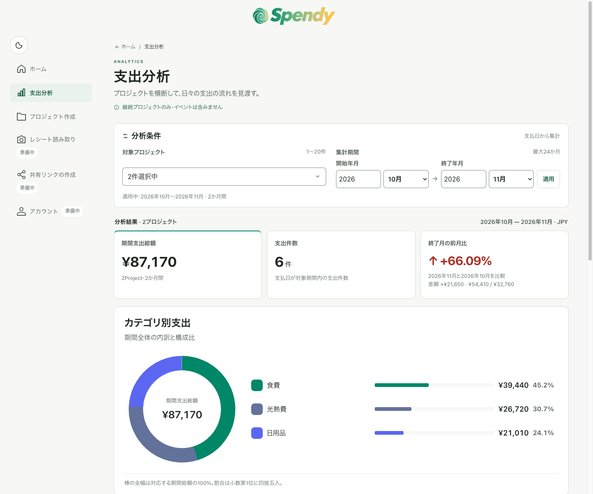
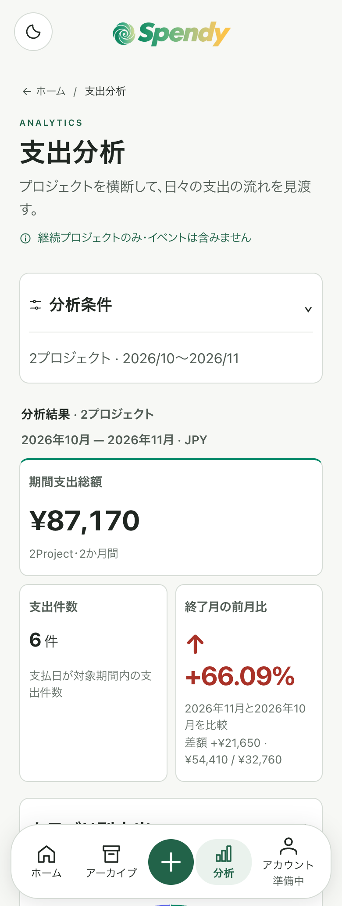

# Spendy


Spendy は、同居や旅行で立て替えた支出を記録し、誰が誰にいくら返せばよいかを計算する日本円の共有支出管理アプリです。家計のような継続支出は月ごとに、旅行やイベントの支出はプロジェクト全体で精算できます。

共同の支出では、支払った人と負担する人が一致するとは限りません。Spendy では支出ごとに負担者と配分を記録し、後から支出を編集しても、精算額の根拠を追えるようにしました。

## ログイン不要のデモ

**[Spendy デモを開く](https://spendingmate-demo.onrender.com/)**

- デモURLを開くと、ログインせずにSpendyを操作できます。
- Render Free は無通信が続くと休止するため、最初の表示に1〜2分程度かかることがあります。
- 架空データ専用の共有台帳です。誰でも同じ台帳を閲覧・変更・削除でき、運用上のリセットもあります。個人情報や実際の支出は入力しないでください。

Render Free の Docker Web Service が React と Spring Boot API を同一オリジンで配信し、Neon Free の専用 PostgreSQL に保存します。[技術設計](docs/portfolio/design.md) の AWS 構成は製品向けの設計です。

### デモの操作ガイド

1. 上の「Spendy デモを開く」からホームを開きます。
2. イベント一覧で「箱根温泉旅行」を選び、「精算結果」で方式を切り替えます。「2方式を比較」で送金経路を並べて確認できます。
3. 継続プロジェクト一覧で「シェアハウスの生活費」を選び、月を切り替えて支出・メンバー別の負担・月次精算を確認します。
4. 「支出分析」で「シェアハウスの生活費」を選び、開始年月を2026年1月、終了年月を2026年12月にして「適用」を押すと、年間の支出推移とカテゴリ別支出を確認できます。

- **シェアハウスの生活費**　3人の共同生活費を管理します。2026年1月〜12月の支出は108件、年間支出総額は2,746,200円です。12月分は将来月として用意した架空サンプルです。
- **箱根温泉旅行**　4人の旅行費を管理します。支出は9件、総額は120,000円です。「わかりやすく精算」は送金3回、「送金回数を少なくする」は2回で、このデータでは約33.33%削減できます。両方式で各人の負担額と送金総額（30,000円）は一致します。「送金回数を少なくする」は差額が大きい支払側と受取側から組み合わせる方式で、数学的な最小送金回数を常に保証するものではありません。

## 画面

ローカルの PostgreSQL に保存した架空の支出を集計した画面です。継続プロジェクト 2 件を選び、2 か月分の支出を比較しています。

| PC | スマートフォン |
| --- | --- |
|  |  |

## 実装した機能

- 継続・イベントのプロジェクト作成、検索、ページング、論理削除
- プロジェクト内のメンバー追加・改名、支払者と負担者を指定した支出登録・編集・削除
- イベント全体と継続プロジェクト月次の精算。送金回数を抑える方式と、メンバーの順番に沿って確認しやすい方式を比較
- イベントのアーカイブと、アーカイブ時点の精算結果の参照
- 継続プロジェクトの月次分析。ローカル版と提出デモ版では、ホーム月次集計と複数プロジェクトの分析を実データベースに接続

## 技術スタック

| 領域 | 技術と採用理由 |
| --- | --- |
| バックエンド | Java 21、Spring Boot 4、Spring MVC、Spring Data JPA、Gradle。検証・計算・永続化を分け、サービス層でトランザクションを管理 |
| データベース | PostgreSQL、Flyway。外部キー・一意制約・行ロックで整合性を維持し、マイグレーション履歴を管理 |
| フロントエンド | React、TypeScript、Vite、TanStack Query、CSS Modules。API の読み込みと更新後の再取得を管理し、PC とモバイルで画面構造を共有 |
| 起動・配信 | ローカルは Docker Compose で PostgreSQL を起動。提出用 Docker イメージは React の静的成果物と Spring の API を同一オリジンで配信 |

## バックエンド設計

- **整数円と配分履歴**　支出額、負担額、残高は Java の `long` と PostgreSQL の `BIGINT` で扱います。均等割りの余りはメンバー表示順で 1 円ずつ配り、配分金額を支出と一緒に保存します。
- **精算の再現性**　受取側と送金側を残高で照合し、方式ごとの精算結果を保存します。対象期間の支出・配分が同じなら既存結果を再利用し、支出変更時は関連する結果を失効させます。
- **同時更新**　支出編集は楽観ロックで古い編集を検知し、競合時に HTTP 409 を返します。支出更新と精算生成は同じプロジェクト行を最初に悲観ロックし、配分の置換・精算結果の失効・採番をそれぞれのトランザクションで確定します。
- **REST API とアクセス境界**　Project を起点に Member・Expense・Settlement を扱い、入力 DTO とレスポンス DTO を永続化モデルから分離します。ローカル集計は明示的に有効にしたループバック環境で動作し、提出デモは専用プロファイルと架空データの専用 DB を使用します。

システム構成図、ER 図、API の一覧、アクセス制御と ADR の要点を技術設計にまとめています。 [技術設計](docs/portfolio/design.md)

## 検証と開発の進め方

通常版・提出デモ版のフロントエンドビルドと、PC幅・スマートフォン幅でのホームとアーカイブの画像表示を検証しました。バックエンドは、PostgreSQL 17 で全408件と実HTTPの集計照合を通過した開発用コミット `27c618e63e816f97246c8d0094fe34ee4f954502` と同一です。画面に使用した値は架空データです。

単体テストで整数円の配分と精算結果、API テストで入力やエラーの契約、PostgreSQL 統合テストで制約・マイグレーション・同時更新の結果を確認できるようにしています。過去の提出デモ検証では、使い捨て PostgreSQL と Chrome を使用し、支出の金額と Home・Analytics の集計を独立した SQL と照合しました。匿名セッションの隔離 PoC は製品のアクセス制御とは別の検証です。

コード品質は SRCS 1.0.0 の要件 ID と差分・検証結果を対応づけ、設計判断は ADR に記録します。AI は調査、実装案、テスト案、レビューの補助に使用します。実装の根拠は仕様と実コードに置き、テストを実行してから結果を記録します。

## ローカルで起動

Java 21、Node.js 22.12 以上、Docker Compose を用意し、リポジトリのルートで実行します。

```bash
(cd frontend && npm ci)
POSTGRES_PORT=127.0.0.1:5432 docker compose up -d --wait postgres
./scripts/dev.sh
```

ブラウザで `http://127.0.0.1:5173` を開き、プロジェクトを作成します。Spring Boot は `127.0.0.1:8080` で待ち受け、Vite が API を転送します。終了は `Ctrl+C`、DB の停止は `docker compose stop postgres` です。

```bash
(cd backend && ./gradlew test)
(cd frontend && npm run build)
```

ローカル起動は開発用です。架空データでの確認に使い、外部公開する場合は専用プロファイルと専用 DB の受入条件を確認します。

## 開発状況

| 状態 | 範囲 |
| --- | --- |
| 実装済み | プロジェクト・支出管理、イベント／月次精算、継続プロジェクト分析、ローカル／提出プロファイルの集計 |
| 設計・一部基盤を実装 | 匿名 Subject／セッション、共有・復旧、プロジェクト単位の権限 |
| 今後 | 匿名アクセスの製品経路への接続と切替検証、任意ログイン、プロジェクトの属性編集、メンバーの無効化・再有効化 |

このポートフォリオのソースは開発用 `main` の `4d78f3257de952a325a44191217291d063cf42ce` を基にしています。プロジェクト独自コードのライセンスは未選定です。依存ライブラリにはそれぞれのライセンスが適用されます。 プロジェクトの既定画像にはSpendy用に制作したオリジナルの図形イラストを使用しています。
