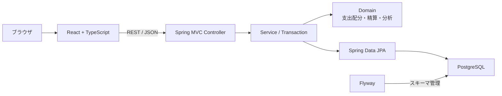
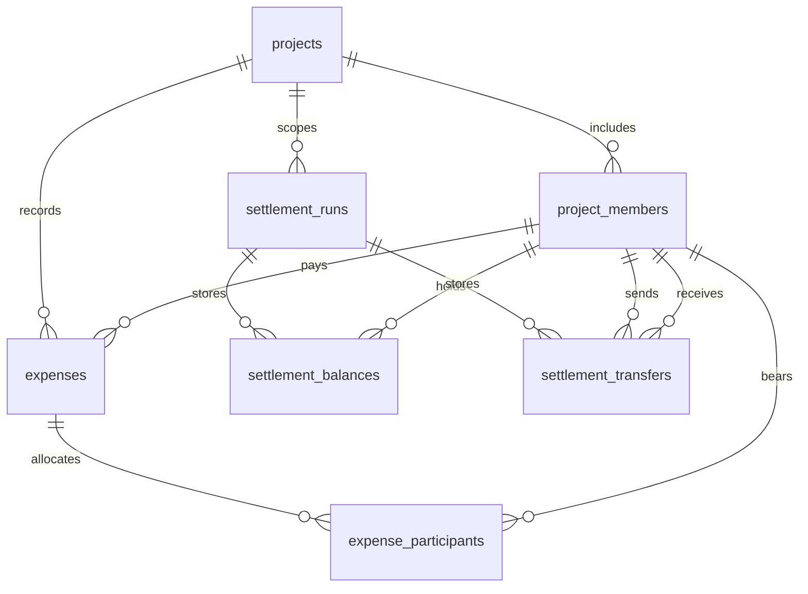

# Spendy 技術設計

## システム構成

ローカル開発では Vite が API を Spring Boot に転送します。提出用イメージは Spring Boot から React の静的ファイルと REST API を同一オリジンで提供します。提出用 DB の起動確認ではデータベース名・接続先・専用識別子を照合し、実行ロールと初期化ロールを分けます。 [Dockerfile](../../Dockerfile)

## データモデル

実装済みの支出・精算の主な関係です。

`project_members` はプロジェクト内の参加者です。支払者と負担者は、対象支出と同じプロジェクトに所属することをサービスで確認します。`expense_participants` には配分順と配分額を保存します。`settlement_runs` と子テーブルは、精算の方式・対象期間・入力指紋・残高・送金結果を記録します。Event はプロジェクト単位、Continuous は年月単位です。 [Flyway マイグレーション](../../backend/src/main/resources/db/migration/)

## REST API

下表の `{publicToken}` はプロジェクトを特定するパスパラメーターです。

| HTTP | パス | 主な用途 |
| --- | --- | --- |
| GET / POST | `/api/projects` | 一覧・新規作成 |
| GET | `/api/projects/page` | 絞り込み・ページング |
| GET / DELETE | `/api/projects/{publicToken}` | 詳細・論理削除 |
| POST / PATCH | `/api/projects/{publicToken}/members`、`/api/projects/{publicToken}/members/{memberId}` | メンバー追加・改名 |
| GET / POST | `/api/projects/{publicToken}/expenses` | 支出一覧・登録 |
| PATCH / DELETE | `/api/projects/{publicToken}/expenses/{expenseId}` | 支出編集・削除 |
| GET | `/api/projects/{publicToken}/settlements` | 精算取得。欠けていれば計算して結果を保存 |
| GET | `/api/projects/{publicToken}/analytics` | 継続プロジェクトの月次分析 |
| POST | `/api/projects/{publicToken}/archive` | Event のアーカイブと書込の停止 |

提出版では有効化した `/api/demo/home/monthly-overview` と `/api/demo/analytics` を使用します。現行の支出更新 API は、更新前のバージョンが合わない場合に `409 Conflict` を返します。 [コントローラー](../../backend/src/main/java/com/splitmate/project/controller/ProjectController.java) · [支出更新サービス](../../backend/src/main/java/com/splitmate/expense/service/ExpenseService.java)

## 精算とトランザクション

1. 支出時点で整数除算と余りの配分を行います。たとえば 1,000 円を 3 人で割ると 334 円、333 円、333 円になります。
2. 各メンバーの残高を支払額と保存済み負担額の差として計算します。残高が負なら送金側、正なら受取側です。
3. 残額の大きい順、またはメンバー順で両者を照合し、送金側の残額と受取側の残額の小さい方を送金額にします。
4. 丸め候補と補正額を記録し、実際の送金が厳密な整数円残高と一致することを確かめます。

精算生成と支出変更は最初に Project 行を `PESSIMISTIC_WRITE` でロックします。支出変更で配分の置換と精算結果の失効が必要な場合、同一トランザクションで行い、月をまたぐ編集では旧月と新月を対象とします。精算生成では入力指紋で現行結果を再利用し、新しい結果の採番とスナップショットを同一トランザクションで保存します。支出バージョンは JPA の `@Version` と API の競合応答に反映します。 [配分](../../backend/src/main/java/com/splitmate/expense/domain/EqualSplitAllocator.java) · [精算計算](../../backend/src/main/java/com/splitmate/settlement/domain/SettlementCalculator.java) · [精算サービス](../../backend/src/main/java/com/splitmate/settlement/service/SettlementService.java)

## アクセス制御と設計判断

- **現行のローカルアプリ**は開発専用です。トークンによる Project 解決と Project 内のデータ整合性を実装しています。利用者ごとの製品認証・認可は設計と基盤整備の段階です。
- **提出デモ**は既定で HTTP Basic による入口制御を使い、架空データの専用 DB を参照します。明示的に公開モードを選んだ場合は来訪者が同じ架空台帳を共有します。書込元の検証と DB ロールの分離は両モードで適用します。
- **ADR-0003／0006**では、Event 全期間と Continuous 月次の精算境界、入力のフィンガープリント、Project を先に取得するロック順を定めました。**ADR-0008／0009**は匿名アクセスとホーム集計の製品契約を定めたもので、製品経路への接続と公開受入は今後の工程です。

## 検証の読みどころ

計算そのもの、API のエラー境界、PostgreSQL 上での競合・永続化を別のテストで確認します。統合テストが必要な場合は使い捨て PostgreSQL を用意します。通常の `./gradlew test` では、環境変数で明示的に有効化が必要な PostgreSQL 統合テストがスキップされます。 [精算計算テスト](../../backend/src/test/java/com/splitmate/settlement/domain/SettlementCalculatorTests.java) · [行ロック統合テスト](../../backend/src/test/java/com/splitmate/settlement/ProjectLockIntegrationTests.java)
